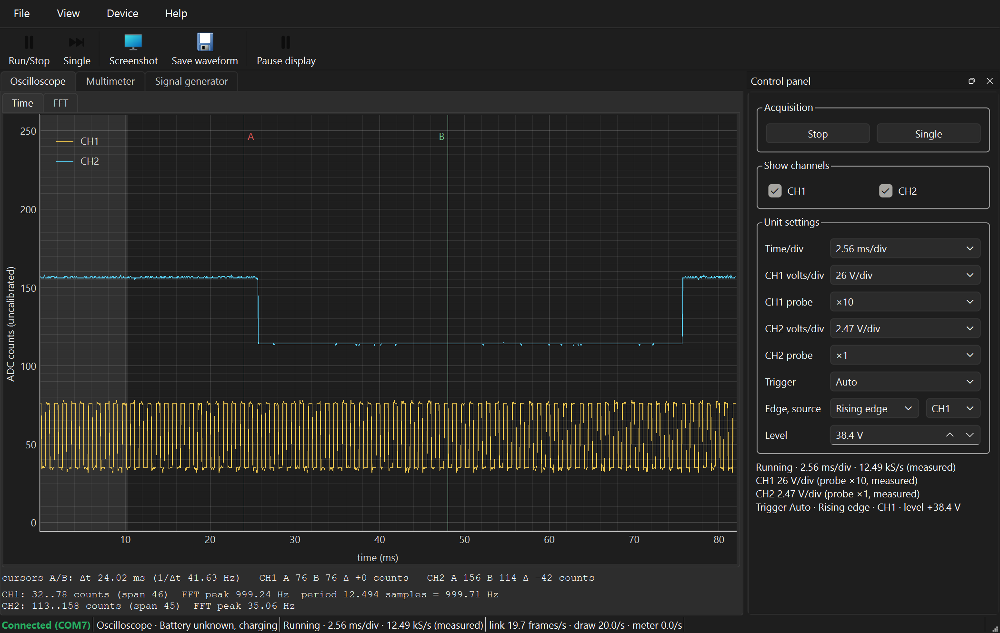

# OpenScope-2C53T-GUI — desktop window for the OpenScope 2C53T

`openscope-gui` is a Windows/Linux/macOS instrument window for a FNIRSI 2C53T that runs the
[OpenScope-2C53T](https://github.com/freudenthal/OpenScope-2C53T) firmware. It uses the USB CDC
remote protocol through the `openscope` host library. That library is in the firmware
repository, at `tools/openscope_host/`, so that the protocol code and the firmware change together.



## Install
Put the two repositories next to each other:

```
<workspace>/
  OpenScope-2C53T/       firmware + tools/openscope_host (the openscope library)
  OpenScope-2C53T-GUI/   this repository
```

```bash
pip install -e ../OpenScope-2C53T/tools/openscope_host
pip install -e .
openscope-gui            # or: python -m openscope_gui.app
```

The `openscope` library is not on PyPI. Install it from your firmware checkout before this
package. The GUI needs a firmware build with the same protocol version as the library.

## The window
* **Tabs are the unit's modes:** Oscilloscope, Multimeter, Signal generator. Click a tab and the
  unit goes to that mode. Press MENU on the unit and the window goes to the matching tab (it
  sends nothing for that). While the unit shows its Settings menu, a line over the tabs says so.
* **Control panel** (right; one panel per tab). Oscilloscope: Run/Stop, Single (trigger Single,
  then run), the channels to show, time/div, volts/div and probe ×1/×10 per channel, trigger
  mode, edge, source and level. The lists show practical values from the unit's own description
  (`openscope describe`): "2.56 ms/div", "26 V/div" (probe included), "≈" for provisional values.
  Settings with no calibrated value are hidden; View ▸ Show uncalibrated settings lists them.
  The level is in volts on the source channel, relative to the middle of the screen (in percent
  of the screen on a range with no volts meaning). Codes (timebase code, range, register value)
  are in the tooltips only. The panel shows the state the unit reports back after each set, never
  the value it asked for. The Signal generator panel comes in a later stage.
* **Multimeter panel:** the meter functions that the firmware marks usable (DC voltage, AC
  voltage, resistance, continuity and diode on API level 2 firmware), by name. A click selects
  the function on the unit; the item shows "changing…" until a reading of that function comes
  (about 2.5 s). A change on the unit (its Function softkey) moves the list and sends nothing.
  Hold (freezes the shown value), Relative (shows the reading minus the reading at the click) and
  minimum/maximum/average are in this program only: they send nothing, and the CSV log keeps the
  readings as measured, with the function name as the last column. Firmware before API level 2
  cannot select functions: the list is disabled and the readings still show.
* **Menus:** File (Save LCD screenshot, Save waveform as CSV or NPZ, Record meter to CSV, Exit),
  View (Control panel, Unit keys, Show uncalibrated settings, Advanced tools), Device (Connect,
  Disconnect, Port, Device information, Back up calibration, Update firmware), Tools (with Advanced tools: Debug console, which never
  sends `cal restore` or `mem write`), Help (About). Window size, dock layout and View choices
  are kept between runs.
* **Toolbar and keys:** Run/Stop (Space), Single, Screenshot (Ctrl+P), Save waveform (Ctrl+S),
  Pause display; F1 About. Run/Stop and Single work only while the unit is in scope mode
  (the firmware refuses scope settings in the other modes: "scope settings need scope mode").
  Shortcuts never send unit key presses. The unit keys dock (View ▸
  Unit keys, hidden by default) sends key presses for functions that have no control yet.
* **Status bar:** connection, unit mode and battery, the scope state in words ("Running ·
  2.56 ms/div · 12.49 kS/s (measured)", "held record", "record taken at …" when the shown
  record was taken with other settings), link and draw rates.

The plot shows raw ADC counts, two cursors (Δt, Δcounts), an FFT tab and the measurements; the
meter tab has the value with its function and unit in words, a strip chart and the CSV log (a
file with older columns is not appended to: the log goes to `<name>-2.csv`). The screenshot stops the scope for the dump and runs
it again, so the screen passes the CRC. The window recovers by itself after an unplug. Bench
options: `--stats CSV` (rates once a second), `--events TXT`, `--meter-log CSV`, `--grab PNG`,
`--quit-after S`, `--channels 1,2`. One reader thread (`worker.py`) owns the port; a 30 Hz
timer draws.

## Back up and update
The library (`openscope` 0.6.0 or later) does the work; the window only guides it.

* **Device ▸ Back up calibration…** reads the unit's calibration page and saves it in a folder
  per unit (`%LOCALAPPDATA%\OpenScope\backups\<unit ID>\<time>`). The dialog shows the
  folder, the CRC32 values and the unit ID, and has an "Open folder" button. Copy the folder to
  a second place: a lost calibration cannot be made again.
* **Device ▸ Update firmware…** opens a wizard with six pages:
  1. *Check*: the unit, its firmware and the image. The image comes from the `firmware` folder
     next to the program (release package) or from the folder in `OPENSCOPE_FIRMWARE_DIR`, or
     you choose a `.bin` file that has its `.manifest.json` next to it. An image that the checks
     refuse cannot go on.
  2. *Backup*: automatic. Next stays off until the backup of this run is verified. On a unit
     with the FNIRSI firmware (first install) the backup comes after the first OpenScope start:
     tick the acknowledgment and type `INSTALL`.
  3. *Upgrade mode*: keep USB connected, hold MENU and tap Power, keep MENU held until the
     upgrade screen shows. If it does not show: hold MENU, press the pinhole reset, keep MENU
     held 3 to 5 s. The wizard finds the drive by itself.
  4. *Copy*: one write of the image (about 11 s). Do not unplug the unit and do not open its
     drive. This page has no Cancel and the wizard cannot close until the update ends.
  5. *Restart*: the wizard waits for the unit's port (up to 60 s) and checks it.
  6. *Result*: the firmware against the manifest, the calibration before and after, and the
     path of the update log.

  During the update the window does not use the port (the wizard has its own connection). After
  Finish the window connects again and reads the unit's description again.
* **Banner:** at connect the window compares the firmware's API level with the level that this
  program needs. When the firmware is too old, has no build identity, answers on the debug shell
  only, or when the unit waits in upgrade mode or runs the FNIRSI firmware, a yellow line over
  the tabs says so, with an "Update firmware…" button. Firmware newer than this program gets a
  note only.
* Return to the FNIRSI firmware is a command-line function only: `openscope update
  --stock-image <file>`.

## Windows release package
`packaging/build_release.ps1` makes the zip for Windows users with no Python: PyInstaller
one-folder build (`packaging/openscope-gui.spec`), the bundled firmware image with its manifest
and `SOURCE.txt` in `firmware\`, `LICENSE.txt`, `THIRD-PARTY-NOTICES.txt` and the end-user
`README.txt` (`packaging/README.txt`). It needs a build venv with PyInstaller, both
repositories with no changes, and a `guest-coldtrace` image of the product HEAD with its
manifest. Output: `<workspace>\releases\openscope-gui-<version>\` and
`openscope-gui-<version>-upload\` (zip and `SHA256SUMS.txt`).

```powershell
powershell -ExecutionPolicy Bypass -File packaging\build_release.ps1 -Version 0.2.0
```

## Layers
| module | job |
|---|---|
| `worker.py` | reader `QThread`: the only owner of the port; jobs in, frames and state out |
| `window.py` | tabs, menus, toolbar, docks |
| `scope_panel.py` | Oscilloscope control panel |
| `meter_panel.py` | Multimeter control panel (function list, Hold, Relative, min/max/average) |
| `dialogs.py` | Device information, Debug console, About |
| `update_wizard.py` | calibration backup dialog, firmware update wizard and its runner thread |
| `labels.py` | practical-unit text from the unit's description |
| `views.py` | plots, FFT, cursors, meter model (host tools), strip chart and CSV |
| `app.py` | entry point (`openscope-gui`) |

## Tests (no hardware)
```bash
python tests/test_gui_labels.py   # practical-unit text from a real device description (no Qt)
python tests/test_gui_worker.py   # reader thread vs a fake Device (skipped without PySide6/numpy)
python tests/test_gui_views.py    # FFT/period helpers, cursor readout, meter CSV (offscreen Qt)
python tests/test_gui_app.py      # the window offscreen: tabs = modes, panel, no codes visible, settings kept
python tests/test_gui_update.py   # banner cases, backup job, the update wizard with a fake flow and drive
python -m unittest discover -s tests -t tests   # all of them
```
If `openscope` is not installed, the suites find it in `../OpenScope-2C53T/tools/openscope_host`,
or in the folder that `OPENSCOPE_HOST` names.

## History
This code was in the firmware repository as `tools/openscope_host/openscope/gui` (package
`openscope.gui`) until it moved here. The first five commits replay that history.

## License
GPL-3.0, the same as OpenScope-2C53T. See `LICENSE`.
